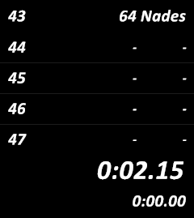

# Jug Grenades Counter (`Bo1_JuggPrenades_SOLO.asl`)

A secondary, standalone LiveSplit Auto Splitter (ASL) script designed for Call of Duty: Black Ops 1 and Black Ops 2 Zombies speedrunning (Jug Side Solo category). It dynamically displays the total number of grenades required for the current round (Rounds 21 to 45) directly in your LiveSplit layout.

<p align="center">
  
</p>

---

## Installation

1. Ensure LiveSplit (1.8.x or newer) and your main autosplitter script are set up.
2. Download [`Bo1_JuggPrenades_SOLO.asl`](https://github.com/ZegosofT/Bo1-Bo2-Autosplitter/releases/download/v0.9.0/Bo1_JuggPrenades_SOLO.asl).
3. Right-click LiveSplit -> **Edit Layout...**
4. Click **`+`** -> **Control** -> **Scriptable Auto Splitter**.
5. Double-click the new Scriptable Auto Splitter component, click **Browse**, and select `Bo1_JuggPrenades_SOLO.asl`.
6. Select or create a comparison whose name contains both `"Jug"` and `"Solo"` (e.g., `"Jug Side Solo r30 SR"`).
7. The grenade counter will automatically appear at the top of your layout during rounds 21 through 45.

---

## Features & Display Format

- **Layout Display:** Adds a dedicated line to LiveSplit showing the current round on the left and the required grenades count on the right (e.g., `24` on the left and `6 Nades` on the right).
- **Companion Script:** Operates as a passive display helper. It does **not** handle game splits, timer starts, or resets (which is why the Start/Split/Reset checkboxes remain greyed out in LiveSplit settings).
- **Auto-Injection & Self-Cleanup:** Automatically injects its text component at the configured layout position (default top index `0`) when entering Round 21, and removes it cleanly after Round 45 or upon resetting.
- **Smart Mode Activation:** Dynamically checks your comparison name (`timer.CurrentComparison`), category name, or game name. The counter activates **only** if the active run name contains both `"Jug"` and `"Solo"` (and does not contain `"Coop"`).
- **Zero Memory Reading:** Reads no active game memory addresses directly; it updates dynamically based on LiveSplit's current split index ($X = \text{CurrentSplitIndex} + 1$).

---

## Grenade Data Reference (Rounds 21–45)

The table below lists the total number of grenades required per round as defined in `vars.grenades`:

| Round | Grenades | Round | Grenades | Round | Grenades |
| :---: | :------: | :---: | :------: | :---: | :------: |
| **21** | 3 Nades | **30** | 15 Nades | **39** | 43 Nades |
| **22** | 4 Nades | **31** | 17 Nades | **40** | 47 Nades |
| **23** | 5 Nades | **32** | 19 Nades | **41** | 53 Nades |
| **24** | 6 Nades | **33** | 22 Nades | **42** | 56 Nades |
| **25** | 7 Nades | **34** | 24 Nades | **43** | 64 Nades |
| **26** | 8 Nades | **35** | 27 Nades | **44** | 71 Nades |
| **27** | 10 Nades | **36** | 31 Nades | **45** | 77 Nades |
| **28** | 12 Nades | **37** | 34 Nades | -- | -- |
| **29** | 14 Nades | **38** | 37 Nades | -- | -- |

*(Note: Data provided as reference values. If a round inside range 21–45 lacks an entry, `? Nades` will be displayed).*

---

## Configuration Options

You can edit the script parameters at the top of the `startup` block:

```csharp
vars.MIN_ROUND = 21;      // First round where the component appears
vars.MAX_ROUND = 45;      // Last round where the component appears
vars.PAD = 0;             // Number of spaces added to left text for split alignment
vars.INSERT_INDEX = 0;    // Position in layout (0 = top; set to 1 if sharing index with SpawnTimes)
vars.SUFFIX = " Nades";   // Label added after the grenade count
```

---

## Troubleshooting & Limitations

- **Greyed-out Start / Split / Reset Checkboxes:** This is expected. The script is purely a display companion and contains no execution blocks for timer actions.
- **Component Not Displaying:**
  - Verify that your game process (`plutonium-bootstrapper-win32`, `BlackOps`, or `BGamerT5`) is running.
  - Verify your active comparison, category, or game name contains both `"Jug"` and `"Solo"` (case-insensitive) and does not contain `"Coop"`.
  - Ensure your split file starts at Round 1 (split index 0).
- **Layout Index Conflicts:** If using both `Bo1-Bo2_SpawnTimes.asl` and `Bo1_JuggPrenades_SOLO.asl`, adjust `vars.INSERT_INDEX` in one of the scripts to `1` so they stack cleanly.
- **Stale Text Components:** Stale components matching current format rules are cleaned automatically at load. Older format components (e.g., `Grenades: 6` on left text) should be deleted manually from the Layout Editor.
- **Limitations:** Alignment spaces (`PAD`) are approximate depending on layout fonts. Split skipping or reordering will shift the active round index.
