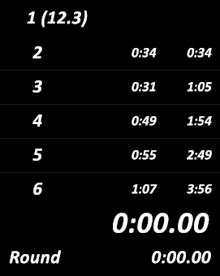

# ⏱️ Last Spawn Display (`Bo1-Bo2_SpawnTimes.asl`)

A secondary, completely passive LiveSplit Auto Splitter (ASL) script designed to display the expected **spawn time** for rounds 1 through 20. 

Unlike the main autosplitter, this script **does not interact with splits or timer states**. It simply reads the current in-game round memory address and dynamically updates a custom layout text line.

<p align="center">
  
</p>

---

## 📥 Download

* **Script File:** [Bo1-Bo2_SpawnTimes.asl](https://github.com/ZegosofT/Bo1-Bo2-Autosplitter/releases/download/v0.9.0/Bo1-Bo2_SpawnTimes.asl)

---

## ✨ Features

- **Automated Round Tracking:** Reads the active round from *Black Ops 1* or *Black Ops 2* (Plutonium, Steam, BGamer).
- **Spawn Time Mapping:** Displays the formatted spawn delay for the current round (e.g., `1 (10.5)` for Round 1 up to `20 (50.2)` for Round 20).
- **Automatic Cleanup:** Automatically removes the text line from your layout once you pass Round 20.
- **Fast Restart Friendly:** Restores and resets the text component cleanly to `1 (10.5)` whenever a map is restarted or reset.

---

## 🛠️ Installation & Setup

1. **Download the script:** Get [`Bo1-Bo2_SpawnTimes.asl`](https://github.com/ZegosofT/Bo1-Bo2-Autosplitter/releases/download/v0.9.0/Bo1-Bo2_SpawnTimes.asl) from the official release.
2. **Add a Text Component in LiveSplit:**
   - Right-click LiveSplit $\rightarrow$ **Edit Layout...**
   - Click **`+`** $\rightarrow$ **Text** $\rightarrow$ **Text**.
   - Open its **Settings** and set **Left Text** to exactly:
     ```text
     last spawn
     ```
   - Leave **Right Text** blank (the script will fill this dynamically). Click **OK**.
3. **Attach the Script:**
   - Click **`+`** $\rightarrow$ **Control** $\rightarrow$ **Scriptable Auto Splitter** (add a second instance if you already have the main autosplitter loaded).
   - Double-click it, click **Browse**, and select `Bo1-Bo2_SpawnTimes.asl`.
   - *(Optional)* Uncheck **Reset** in the script settings if you want your main autosplitter to handle resets exclusively.

---

[⬅️ Back to Main Documentation](../../README.md)